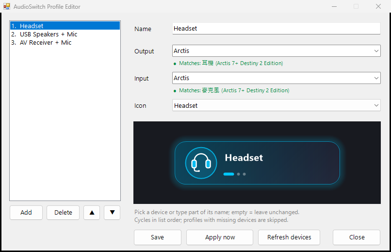

# AudioSwitch

**English** | [繁體中文](README.zh-TW.md)

One-click switching of the Windows **default audio devices**. Group an output and an input into a *profile* (e.g. headset, USB speakers + microphone, AV receiver + microphone), bind it to a mouse button, and each press cycles to the next profile.

It changes the system *default* devices, so Discord, Teams, games and so on follow automatically as long as they are set to "Default device" — no per-app settings.

Works with any mouse software that can launch a program on a button press (Razer Synapse, Logitech G HUB, etc.) — no vendor SDK needed.



## Features

- **Profiles:** output device + input device + name + icon; as many as you like
- **One-press cycling:** moves to the next profile; profiles whose devices are missing (e.g. the receiver is off) are skipped automatically
- **Top-right popup card:** just an icon and the name; slides in and fades out, never steals focus, mouse clicks pass through
- **Tray icon:** pick a profile or a single device by hand
- **Graphical editor:** add, delete, reorder, live preview, and a live check that each device is currently found
- **No admin rights, no extra runtime** (uses the .NET Framework 4 that ships with Windows)
- **UI language follows Windows:** English or Traditional Chinese

| Headset | USB speakers + mic | AV receiver + mic |
|---|---|---|
|  |  |  |

## Install

Download `AudioSwitch-Setup-x.y.z.exe` from [Releases](../../releases) and run it.

- Installs per user — no administrator rights needed
- Optional: start the tray icon with Windows
- Profiles are stored in `%APPDATA%\AudioSwitch\profiles.txt` and are kept when you uninstall

A portable `.zip` is also provided on the Releases page. Windows SmartScreen may warn about an unsigned program the first time: click *More info → Run anyway*.

## Usage

1. Open **AudioSwitch Profile Editor** from the Start menu. Click **Add** (it pre-fills the devices you are using right now), adjust, then **Save**.
2. In your mouse software, bind a button to *Launch program* and pick **`AudioSwitch-Profile.exe`** from the install folder.
3. Press the button: the next profile is applied and a card appears at the top right.

### The programs

One executable is installed under several names; its behavior is chosen by the file-name suffix (many mouse tools cannot pass command-line arguments to a launched program):

| File | What it does |
|---|---|
| `AudioSwitch-Profile.exe` | Cycle to the next profile **← bind this to your mouse button** |
| `AudioSwitch-Tray.exe` | Resident tray icon to pick a profile or device by hand |
| `AudioSwitch-Editor.exe` | Profile editor |
| `AudioSwitch-Out.exe` | Cycle only the output (playback) device |
| `AudioSwitch-In.exe` | Cycle only the input (recording) device |

`AudioSwitch.exe` also accepts arguments: `profile`, `out`, `in`, `list` (print device names). After `out`/`in` you may add name keywords to cycle only between matching devices.

### Profile file format

The editor writes a plain text file you can also edit by hand:

```
# name | output keyword | input keyword | icon
Headset | Arctis | Arctis | headset
USB Speakers + Mic | Realtek USB | Yeti | usbmic
```

- A keyword is any part of the device name (case-insensitive); empty means "leave that side unchanged"
- Icons: `headset`, `speaker`, `mic`, `usbmic`, `amp`; guessed from the name if omitted

## Build from source

Only the compiler that ships with Windows is needed — no Visual Studio:

```
build.bat
```

Output goes to `dist\`. To build the installer, install [Inno Setup 6](https://jrsoftware.org/isinfo.php) and run:

```
"%LOCALAPPDATA%\Programs\Inno Setup 6\ISCC.exe" /DAppVersion=1.1.0 installer\AudioSwitch.iss
```

Set the environment variable `AUDIOSWITCH_LANG=en` or `zh` to force a UI language.

## How it works, and limits

- Devices are enumerated with the public Core Audio API (`IMMDeviceEnumerator`).
- The default device is set through the **undocumented** `IPolicyConfig` COM interface (`SetDefaultEndpoint`); Windows has no public API for this. Many similar tools do the same, but a future Windows update could in theory change it.
- A profile sets the default for all three roles (console / multimedia / communications).
- The popup card may not appear over **exclusive-fullscreen** games (borderless windowed is fine).
- Devices are matched by name keyword, not by device ID; if Windows or a driver renames a device, update the keyword in the editor.

## License

[MIT](LICENSE)
