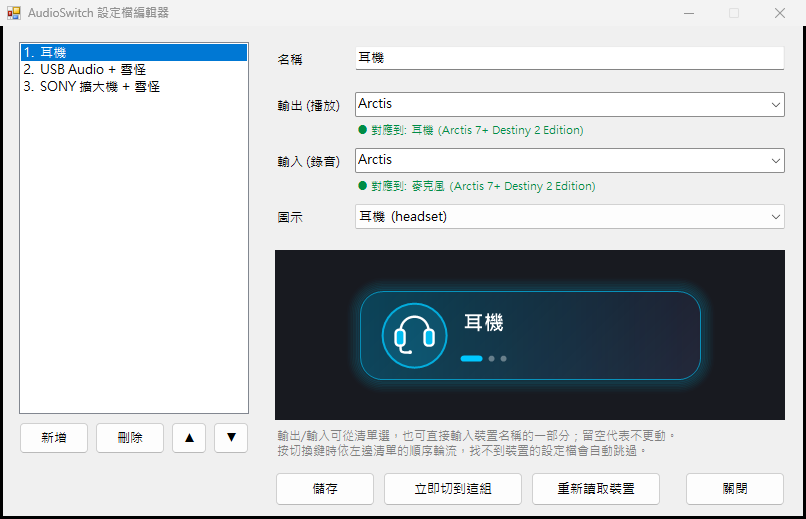

# AudioSwitch

[English](README.md) | **繁體中文**

一鍵切換 Windows **預設音訊裝置**的小工具。可以把「輸出 + 輸入」組成設定檔（例如：耳機、USB 喇叭 + 麥克風、擴大機 + 麥克風），綁在滑鼠側鍵上，按一下就輪換。

切換的是系統「預設裝置」，所以 Discord、Teams、遊戲等只要裝置選「預設」，就會自動跟著換，不用每個程式各自設定。

只要滑鼠軟體支援「按鍵啟動程式」就能用（雷蛇 Synapse、羅技 G HUB 等），不需要任何廠商 SDK。



## 特色

- **設定檔：** 一組 = 輸出裝置 + 輸入裝置 + 名稱 + 圖示，可以有很多組
- **一鍵輪換：** 依順序切到下一組；找不到裝置（例如擴大機沒開）的設定檔自動跳過
- **右上角提示卡：** 只顯示圖示和名稱，滑入、淡出，不搶焦點、滑鼠可穿透
- **托盤圖示：** 點一下就能手動選設定檔或單獨選裝置
- **圖形化編輯器：** 新增、刪除、排序，即時預覽，並顯示目前有沒有對應到裝置
- **不需要系統管理員權限**，不需要額外安裝 .NET（用 Windows 內建的 .NET Framework 4）
- **介面語言跟隨 Windows：** 繁體中文或英文

| 耳機 | USB + 麥克風 | 擴大機 + 麥克風 |
|---|---|---|
|  |  |  |

## 安裝

到 [Releases](../../releases) 下載 `AudioSwitch-Setup-x.y.z.exe` 執行即可。

- 安裝在使用者資料夾，不需要系統管理員權限
- 可選「開機自動啟動托盤圖示」
- 設定檔存在 `%APPDATA%\AudioSwitch\profiles.txt`，解除安裝不會刪除

Releases 頁面也提供免安裝的 `.zip`。第一次執行時 Windows SmartScreen 可能因為程式未簽章而警告，按「其他資訊 → 仍要執行」即可。

## 使用

1. 開始功能表打開 **AudioSwitch 設定檔編輯器**，按「新增」建立設定檔（會自動帶入你目前正在用的輸出和輸入裝置），調整後按「儲存」。
2. 在滑鼠軟體把某個按鍵設成「啟動程式」，選安裝資料夾裡的 **`AudioSwitch-Profile.exe`**。
3. 按那個鍵，就會切到下一組設定檔，並在右上角顯示提示卡。

### 程式一覽

同一個程式以不同檔名安裝，程式依檔名結尾決定行為（因為有些滑鼠軟體的「啟動程式」不能帶參數）：

| 檔案 | 功能 |
|---|---|
| `AudioSwitch-Profile.exe` | 輪換到下一組設定檔 **← 綁滑鼠用這個** |
| `AudioSwitch-Tray.exe` | 常駐托盤圖示，手動選設定檔或裝置 |
| `AudioSwitch-Editor.exe` | 設定檔編輯器 |
| `AudioSwitch-Out.exe` | 只輪換輸出（播放）裝置 |
| `AudioSwitch-In.exe` | 只輪換輸入（錄音）裝置 |

也可以用參數執行 `AudioSwitch.exe`：`profile`、`out`、`in`、`list`（列出裝置名稱）。`out`/`in` 後面可接名稱關鍵字，只在符合的裝置間輪換。

### 設定檔格式

編輯器存的是純文字檔，也可以直接用記事本編輯：

```
# 名稱 | 輸出裝置關鍵字 | 輸入裝置關鍵字 | 圖示
耳機 | Arctis | Arctis | headset
USB 喇叭 + 麥克風 | Realtek USB | Yeti | usbmic
```

- 關鍵字只要是裝置名稱的一部分即可（不分大小寫），留空代表不更動該類裝置
- 圖示：`headset`、`speaker`、`mic`、`usbmic`、`amp`；不寫會依名稱猜

## 從原始碼建置

只需要 Windows 內建的 .NET Framework 編譯器，不需要 Visual Studio：

```
build.bat
```

輸出在 `dist\`。要打包安裝程式，另外安裝 [Inno Setup 6](https://jrsoftware.org/isinfo.php)：

```
"%LOCALAPPDATA%\Programs\Inno Setup 6\ISCC.exe" /DAppVersion=1.1.0 installer\AudioSwitch.iss
```

設定環境變數 `AUDIOSWITCH_LANG=en` 或 `zh` 可強制指定介面語言。

## 運作原理與限制

- 列舉裝置用公開的 Core Audio API（`IMMDeviceEnumerator`）。
- 設定預設裝置用 **未公開** 的 `IPolicyConfig` COM 介面（`SetDefaultEndpoint`），Windows 沒有公開的 API 可以做這件事。許多同類工具也是這樣做；缺點是 Windows 未來更新理論上可能改變它。
- 一組設定檔會同時設定「一般 / 多媒體 / 通訊」三種角色的預設裝置。
- 提示卡在**獨佔全螢幕**的遊戲上可能蓋不上去（無邊框視窗化沒問題）。
- 用關鍵字比對裝置名稱，而不是裝置 ID；如果 Windows 或驅動改了裝置名稱，要在編輯器裡更新關鍵字。

## 授權

[MIT](LICENSE)
